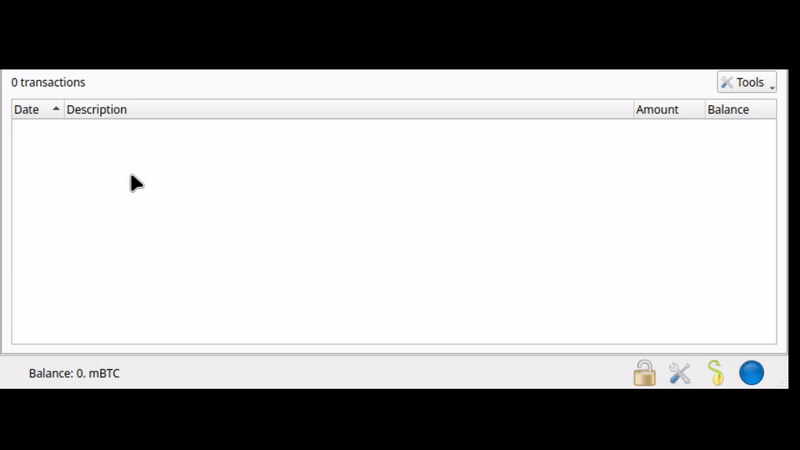

# Passphrase Leak Checker for Electrum

This extension checks seed-extension passphrases and wallet passwords against known password breach data, directly in Electrum's Qt interface. It uses values already entered in the wallet wizard or displayed under **Wallet → Seed**, without asking users to enter them again.

Status: Release candidate. This extension has not undergone an independent security review. Use at your own risk.

## Motivation

A few years ago, I noticed that many people refer to passphrases as a "13th word" and choose their passphrase as they would choose a password. Since people often choose weak passwords or reuse passwords across different services, and good password managers provide leak checks, I thought Bitcoin wallets should implement this functionality too. Otherwise, wallets protected by weak passphrases may be susceptible to offline dictionary attacks if their seeds are compromised.

With the recent (2026) COLDCARD incident, where the entropy used to generate wallet seeds turned out to be insufficient, a strong passphrase could have determined whether a user had enough time to migrate their funds to a new wallet. See [ckTripwire](https://cktripwire.com/).

This extension may help prevent loss of funds at two points: when a user is about to generate or import a wallet with a leaked passphrase, and when a passphrase protecting an existing wallet is found in breach data. Note that a passphrase not found in breach data is not necessarily strong or secure.

## Installation

Building requires Python 3.10+. The plugin runs on Electrum 4.8.3 (Qt). Electrum must be installed separately.

Build the plugin:

```sh
python3 scripts/build_electrum.py
```

1. In Electrum, go to **Tools → Plugins → Add**. If prompted for a password, enter it and click **Add** again.
2. Install `dist/electrum-passphrase-leak-checker-0.1.0.zip`.
3. Enable **Passphrase Leak Checker** and restart Electrum.

To upgrade, remove the old plugin, install the new ZIP, and restart Electrum.

## How to Use



1. During wallet creation or restoration, choose to extend the seed with custom
   words and enter the passphrase in **Seed Extension**. For an existing wallet,
   open **Wallet → Seed**.
2. Click **Check for Leaks** beside the extension; no extra entry is needed.
3. Review the destination and hash disclosure, then approve or decline.

To check the seed extension whenever a wallet opens, go to **Tools → Plugins → Passphrase Leak Checker → Settings** and enable **Check seed extension when a wallet opens**. Confirm and save.

This is disabled by default. Once enabled, startup checks run without prompting and only notify you if a leak is found. If the extension is locked or unavailable, the check is skipped. Errors are also silent, so the absence of a notification doesn't necessarily mean the check succeeded.

To check a passphrase or wallet password manually, go to **Tools → Passphrase Leak Checker** and choose the appropriate **Value type**. Password fields also have their own **Check for Leaks** buttons.

If the buttons don't appear, make sure the plugin is enabled and restart Electrum.

## Considerations

Match counts show how many times a password or passphrase appears in known breach data. They do not represent separate breaches or mean that your wallet was compromised.

By default, the checker sends the first five hexadecimal characters of the SHA-1 hash to Have I Been Pwned's range API. The plaintext never leaves your device, and hash comparison happens locally. The service can see the hash prefix, which reveals some information about the input. Full-hash mode sends the entire hash and requires explicit approval.

Without a proxy or Tor, the service can also see your IP address.

Passwords, seed extensions, and hashes are not saved in settings or lookup history.

See [SECURITY.md](SECURITY.md) for known limitations.

## Development

Tests require PyQt5 or PyQt6. Install the test dependencies using `.[test-qt5]` or `.[test-qt6]`.

Run the offline suite, which blocks DNS lookups and network sockets:

```sh
python3 scripts/test.py --suite offline --strict
```

The full suite also tests loopback connections and deliberately slow responses. All tests use public, synthetic values.

```sh
python3 scripts/test.py --strict
```

Licensed under [MIT](LICENSE).
